# Tutorial de piano para alabanzas

Por: Washington Indacochea Delgado  
[wachin.id@gmail.com](wachin.id@gmail.com)  
2026 Octure  | Jipijapa

Saludos alumnos, Dios les bendiga. Aquí les presento este tutorial de clases iniciales de piano.

Este tutorial está pensado para alumnos de **8 a 15 años**. No hace falta saber nada de música antes de empezar: solo querer aprender y practicar un poquito cada día.

## Cómo usar este tutorial

Cada clase tiene la misma forma:

- 🎯 **Objetivo:** lo que vas a aprender.
- ✋ **Ejercicio:** lo que tienes que tocar.
- ⭐ **Reto:** la meta de la clase. Si te sale, puedes pasar a la siguiente.
- ✅ **Lista:** para marcar lo que ya lograste.

Las clases se pueden leer en orden. Si algo te cuesta, no te preocupes: vuelve a la clase anterior y practica un poco más. Nadie aprende piano en un día.

## Las clases del curso

1. Cómo sentarse y los números de los dedos
2. Las 7 notas musicales y sus 5 sostenidos
3. Acordes mayores
4. Acordes menores
5. La corona del Rey: ubicar Do, Re, Mi
6. Primera alabanza: "La niña de tus ojos"
7. Los nombres de los acordes en inglés
8. La aplicación "Perfect Piano" para ensayar en casa
9. El pulso y el compás de 4 tiempos
10. La escala de Do
11. Inversiones: acordes sin saltar
12. Arpegios: acordes que suenan bonito
13. La mano izquierda y el bajo
14. Bemoles: las notas que faltaban
15. Acordes con sostenido: Do#, Re#, Fa#, Sol#, La#
16. Segunda alabanza: "Hay libertad"
17. Rutina de práctica y meta del alumno

---

# Clase 1: Cómo sentarse y los números de los dedos

Antes de tocar una sola nota, aprendemos a sentarnos. Si te sientas bien, las manos trabajan mejor y no te cansas.

## La postura

- **Espalda derecha**, como si alguien te estuviera sosteniendo con un hilo desde la cabeza.
- **Pies en el piso**, apoyados completos. Si el asiento es muy alto, usa un libro o un banquito.
- **Codos** un poquito más altos que las teclas, pero relajados, no pegados al cuerpo.
- **Manos curvas**, como si sostuvieras una pelota pequeña por dentro.
- **Muñeca relajada**, sin doblarla hacia abajo ni hacia arriba.
- **Uñas cortas**: con uñas largas el dedo no se apoya bien.

> 🧠 Truco: si tus dedos se ven como las patas de un cangrejo, están bien. Si se ven planos como una tabla, están mal.

## Los números de los dedos

En el piano los dedos no tienen nombre para nosotros: tienen **número**. Y es igual en las dos manos.

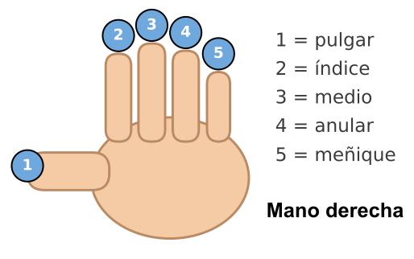{width=8cm}

Cuando en una partitura o en un ejercicio veas un número encima de una nota, ese número te dice **con qué dedo tocarla**.

✋ **Ejercicio de la araña:** apoya los cinco dedos sobre Do, Re, Mi, Fa y Sol (uno por tecla, el pulgar en Do). Ahora levanta y baja un dedo a la vez, sin mover los otros. Primero 1, después 2, después 3, 4 y 5. Luego al revés.

⭐ **Reto:** hacer el ejercicio de la araña con la mano derecha y después con la izquierda, sin apurar y sin que se muevan los otros dedos.

- ✅ Ya puedo sentarme bien y sé qué número tiene cada dedo.

---

# Clase 2: Las 7 notas musicales y sus 5 sostenidos

Existen 7 notas musicales que son:

Do, Re, Mi, Fa, Sol, La, Si

y de estas unas tienen sostenidos, las cuales son:

Do#, Re#, Fa#, Sol#, La#

Los sostenidos (#) son la misma nota, pero un poco más aguda.

## Notas con sostenidos (#)

Notas con su tecla negra al lado (sostenido):

| Nota | Sostenido |
| ---- | --------- |
| Do   | Do#       |
| Re   | Re#       |
| Fa   | Fa#       |
| Sol  | Sol#      |
| La   | La#       |

👉 **Mi y Si NO tienen sostenidos.**

> Más adelante, en la clase 14, vas a ver que esas mismas teclas negras también tienen otro nombre: **bemoles**.

Entonces son 7 notas con nombre y 12 sonidos distintos:

| Nota | Sostenido |
| ---- | --------- |
| Do   | Do#       |
| Re   | Re#       |
| Mi   |           |
| Fa   | Fa#       |
| Sol  | Sol#      |
| La   | La#       |
| Si   |           |

> 🧠 Truco para no olvidar: las teclas negras van en grupos de **dos** y de **tres**. El grupo de dos está entre Do y Mi. El grupo de tres está entre Fa y Si.

⭐ **Reto:** tocar todas las teclas blancas de Do a Si y decir el nombre en voz alta, sin mirar la tabla.

---

# Clase 3: Acordes de piano mayores

Acordes mayores (sonido alegre). Un acorde es cuando tocamos **3 notas al mismo tiempo**.

Los acordes mayores suenan **alegres y firmes**.

En las siguientes imágenes podrán ver la disposición de las notas en un teclado y los acordes:

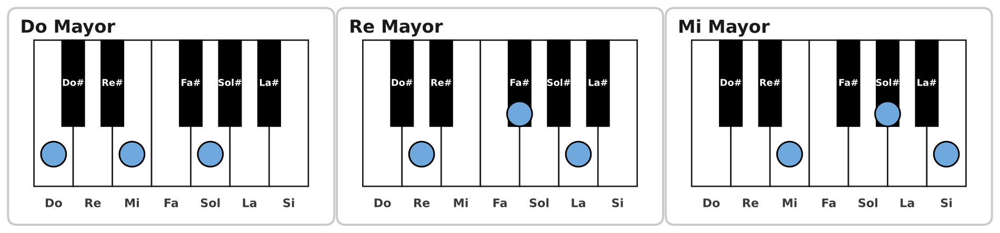{width=16cm}

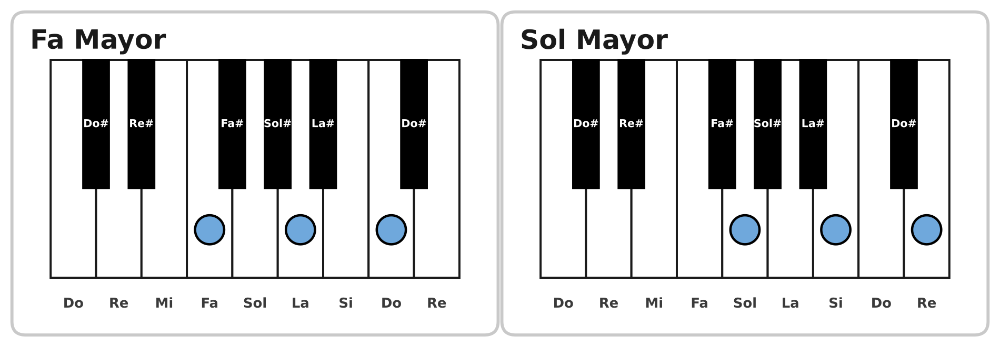{width=16cm}

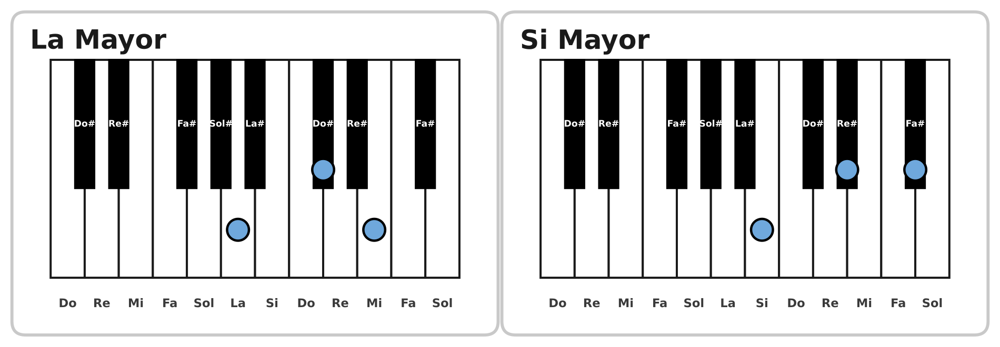{width=16cm}

## El truco de "toca una y salta una"

Este truco sirve para armar **tres acordes distintos**, mirando solo las **teclas blancas**:

- **Do mayor** = Do – Mi – Sol
- **Fa mayor** = Fa – La – Do
- **Sol mayor** = Sol – Si – Re

Son tres acordes separados, no uno. Los tres se arman con el mismo truco.

La regla es una sola:

> **De las teclas blancas que siguen, tocas la 1ª, la 3ª y la 5ª. La 2ª y la 4ª no se tocan.**

"Saltar" quiere decir **no tocarla**: el dedo pasa por encima y sigue. Y las teclas negras **no se cuentan**, como si no existieran.


### Paso a paso con Do

Las instrucciones están en la siguiente imagen:

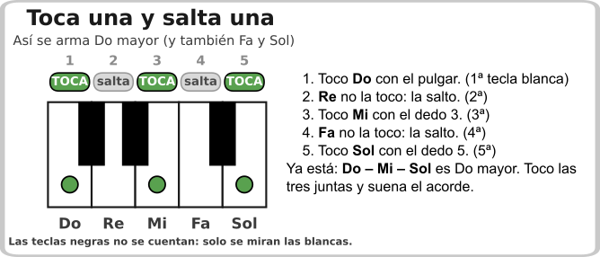

### Los tres acordes con el mismo truco

Lo único que cambia es la tecla donde empiezas:

| Acorde | 1ª (toco) | 2ª (salto) | 3ª (toco) | 4ª (salto) | 5ª (toco) |
| ------ | --------- | ---------- | --------- | ---------- | --------- |
| **Do mayor** | Do | Re | Mi | Fa | Sol |
| **Fa mayor** | Fa | Sol | La | Si | Do |
| **Sol mayor** | Sol | La | Si | Do | Re |

> 🧠 En Fa y en Sol el truco se pasa al **Do siguiente**, el de la octava de arriba. No te detengas en el Si: sigue contando hacia la derecha.

> 🧠 Este truco funciona solo cuando las tres notas son blancas. Cuando el acorde lleva teclas negras (Do#, Re#, Fa#...), se usa el truco de la clase 15.

⭐ **Reto:** tocar Do, Fa y Sol mayores sin mirar las imágenes, diciendo en voz alta "toca, salto, toca, salto, toca".

---

# Clase 4: Acordes de piano menores

Y los acordes menores son los siguientes:

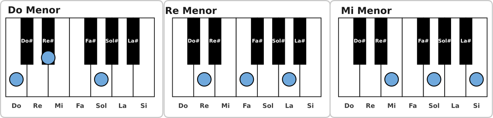{width=16cm}

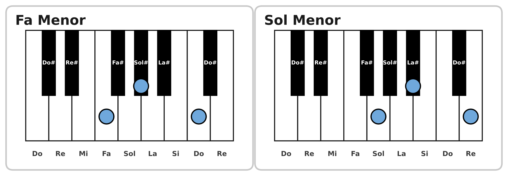{width=16cm}

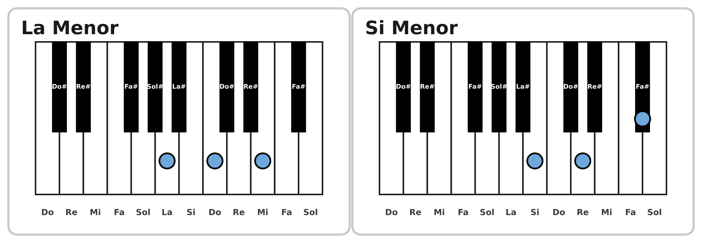{width=16cm}

Los acordes menores suenan **tristes o tranquilos**, como una canción que cuenta algo bonito pero con calma.

## El truco del acorde menor

Un acorde menor es casi igual que el mayor, pero **la nota del medio baja una tecla**.

- Do mayor: Do – Mi – Sol  
- Do menor: Do – Mi♭ – Sol (el Mi baja a la tecla negra de al lado)

⭐ **Reto:** tocar Do mayor y Do menor una después de la otra y escuchar la diferencia.

---

# Clase 5: La corona del Rey para ubicar Do, Re, Mi

Si se les hace difícil entender la ubicación de los acordes en el teclado, imaginen lo siguiente: que las teclas Do, Re, Mi junto con sus sostenidos son **una corona de un Rey**, y la primera nota que está a la izquierda es Do, como en la siguiente imagen:

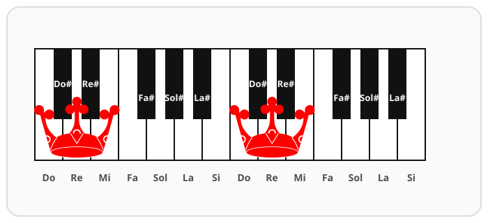{width=13cm}

Así podrán ubicar los elementos del teclado más fácilmente.

> 🧠 Otra forma de verlo: busca el grupo de **dos teclas negras**. La tecla blanca que está justo a la izquierda de ese grupo es **Do**. Y la tecla blanca que está justo a la izquierda del grupo de **tres teclas negras** es **Fa**.

⭐ **Reto:** con los ojos cerrados, poner el dedo 1 en un Do cualquiera del teclado. Abrir los ojos y comprobar.

---

# Clase 6: Aprender la alabanza "La niña de tus ojos"

Vamos a aprender esta alabanza que tiene sólo cuatro acordes y es fácil de ejecutar:

```
La niña de tus ojos
Daniel Calveti

INTRO x2
Do  Sol  Lam  Fa

VERSO I x2
            Do                  Sol
Me viste a mi cuando nadie me vio
             Lam                 Fa
Me amaste a mi cuando nadie me amo

VERSO II x2
            Do               Sol
Y me diste nombre yo soy tu niña
               Lam                      Fa
La niña de tus ojos por que me amaste a mí

PRE-CORO x2
             Do              Sol
Me amaste a mí, Me amaste a mí,
             Lam             Fa
Me amaste a mí, Me amaste a mí

CORO x4
Do                   Sol
Te amo más que a mi vida,
                     Lam
te amo más que a mi vida,
                           Fa
Te amo más que a mi vida, más
```

🎯 Objetivo:

✔ Cambiar entre estos 4 acordes sin parar  
✔ Mantener ritmo constante  

Estos acordes son para que ustedes observen donde van los acordes musicales y los puedan poner en el teclado (sea físico si tengan un teclado en sus casas o desde un Celular donde pueden instalar "Perfect Piano" App).

⭐ **Reto:** tocar la introducción cuatro veces seguidas, contando 1 2 3 4 en voz alta, sin detenerte.

---

# Clase 7: Los nombres de los acordes en inglés

También es importante que se vayan aprendiendo los nombres de los acordes en inglés:

Do = C  
Re = D  
Mi = E  
Fa = F  
Sol = G  
La = A  
Si = B  

Pues cuando uno busca acordes en internet la gran mayoría viene con los acordes en inglés, como ejemplo mismo la alabanza "La niña de tus ojos":

```
La niña de tus ojos
Daniel Calveti

INTRO
C G Am F
C G Am F

VERSO I x2
         C                  G
Me viste a mi cuando nadie me vio
          Am                 F
Me amaste a mi cuando nadie me amo

VERSO II x2
            C                G
Y me diste nombre yo soy tu niña
               Am                     F
La niña de tus ojos por que me amaste a mí

PRE-CORO x2
          C               G
Me amaste a mí, Me amaste a mí,
          Am              F
Me amaste a mí, Me amaste a mí

CORO x4
C                        G
Te amo más que a mi vida,
                         Am
te amo más que a mi vida,
                           F
Te amo más que a mi vida, más
```

## La letra pequeña también importa

| En internet ves | Significa |
| --------------- | --------- |
| C  | Do mayor |
| Cm | Do menor |
| Am | La menor |
| F  | Fa mayor |

La **m** minúscula siempre quiere decir **menor**.

⭐ **Reto:** escribir en un papel los 7 acordes mayores con sus dos nombres (Do / C, Re / D...).

---

# Clase 8: Instalar la App "Perfect Piano" para ensayar en casa

Busque en la "PlayStore" la App "Perfect Piano" así como le muestro en la siguiente imagen:

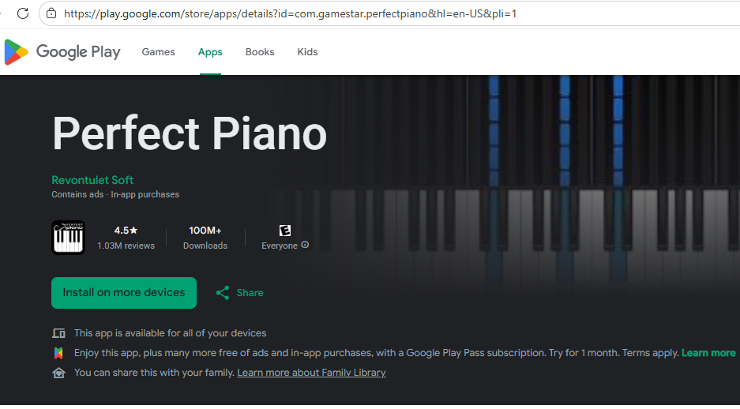{width=8cm}

e instálela.

Pueden buscar algún tutorial en youtube para ayudarse a usarlo, también pueden ver un tutorial que he hecho yo, lo pueden encontrar con este título:

"Perfect Piano Android: Cómo Instalar, Configurar y Usar SIN LATENCIA (Guía Completa)"

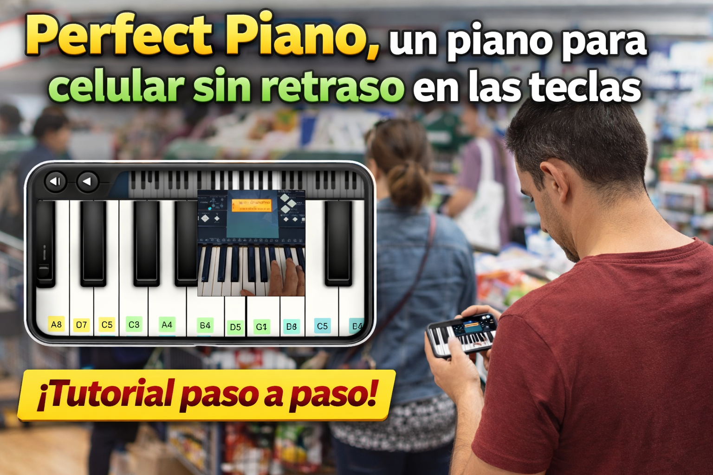{width=12cm}

Una de las ventajas de usar Perfect Piano es que puedes practicar en cualquier momento, no solo frente a un teclado físico.

🛒 **Mientras haces fila en el supermercado**  
Esos minutos de espera se pueden convertir en práctica real de coordinación, escalas o acordes.

🚗 **Esperando dentro del auto**  
Si estás esperando a alguien, puedes repasar posiciones de manos, digitación o progresiones sin necesidad de llevar un teclado.

🛋️ **En casa, lejos del instrumento**  
Aunque no tengas el teclado cerca, puedes mantener activa la memoria muscular y la ubicación de las notas.

⏳ **Prácticas cortas, pero frecuentes**  
Pequeñas sesiones de 5–10 minutos varias veces al día ayudan más que practicar solo una vez por semana.

🧠 **Refuerza la memoria musical**  
Tocar visualmente las notas en pantalla ayuda a que tu cerebro reconozca más rápido patrones, acordes y escalas.

⭐ **Reto:** tocar los cuatro acordes de "La niña de tus ojos" en el celular, con audífonos, sin mirar dónde están las teclas.

---

# Clase 9: El pulso y el compás de 4 tiempos

## ¿Qué es el pulso?

El pulso es el **latido de la música**. Es como cuando caminas: un pie, el otro pie, un pie, el otro pie. Siempre igual, siempre parejo.

Si el pulso se te apura, la canción se cae. Si se te hace lento, la canción se duerme. Lo importante es que **no cambie**.

## Contar hasta cuatro

Casi todas las alabanzas que vamos a tocar están en **compás de 4 tiempos**. Eso significa que contamos así:

**1 – 2 – 3 – 4 – 1 – 2 – 3 – 4 – 1 – 2 – 3 – 4...**

Y el **1** siempre se siente más fuerte. Como cuando cuentas "¡UNO!, dos, tres, cuatro".

## Las figuras: cuánto dura cada nota

| Figura | Nombre | Dura | Cuentas |
| ------ | ------ | ---- | ------- |
| Redonda | 4 tiempos | 4 | 1 – 2 – 3 – 4 |
| Blanca | 2 tiempos | 2 | 1 – 2 |
| Negra | 1 tiempo | 1 | 1 |
| Corchea | medio tiempo | 0,5 | "y" |

✋ **Ejercicio con palmas:** cuenta 1 2 3 4 en voz alta y da una palmada en cada número. Hazlo 10 veces seguidas sin apurarte. Después hazlo dando palmadas solo en el 1 y en el 3.

✋ **Ejercicio en el teclado:** toca el acorde de Do en el 1 y en el 3, y deja sonar mientras cuentas 2 y 4.

> 🐢 Consejo: practica lento, como una tortuga. Lento y parejo siempre gana. Rápido y desordenado no sirve.

⭐ **Reto:** mantener 1 2 3 4 durante una canción completa sin perder la cuenta.

---

# Clase 10: La escala de Do

La escala es una escalera de notas: subes de Do a Do pasando por todas las teclas blancas.

**Do – Re – Mi – Fa – Sol – La – Si – Do**

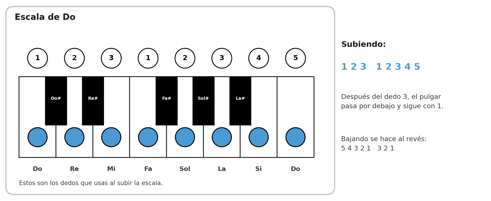{width=16cm}

## La digitación de la escala

Al subir usas estos dedos:

**1 2 3 – 1 2 3 4 5**

Después del dedo 3 (Mi), el pulgar **pasa por debajo** y sigue con 1 en Fa. Es el movimiento más importante de la mano: se llama **paso del pulgar**.

Al bajar se hace al revés:

**5 4 3 2 1 – 3 2 1**

## ¿Para qué sirve la escala?

- **Calienta los dedos** antes de tocar.
- Te enseña **dónde está cada nota** sin mirar.
- Es la base de casi todo lo que vas a tocar después.

✋ **Ejercicio diario:** subir y bajar la escala de Do cinco veces seguidas, despacio, con la mano derecha. Después cinco veces con la mano izquierda.

> 🧠 Truco: di el nombre de la nota en voz alta mientras la tocas. Así el oído y la mano aprenden juntos.

⭐ **Reto:** tocar la escala de Do subiendo y bajando, sin mirar el teclado y sin equivocarte.

---

# Clase 11: Inversiones, acordes sin saltar

## El problema

Cuando tocas Do mayor (Do – Mi – Sol) y después Sol mayor (Sol – Si – Re), la mano tiene que **saltar**. Y cuando saltas, pierdes el ritmo.

## La solución: invertir el acorde

Las **inversiones** son las mismas tres notas, pero puestas en otro orden. Suenan casi igual, pero quedan más cerca de la mano.

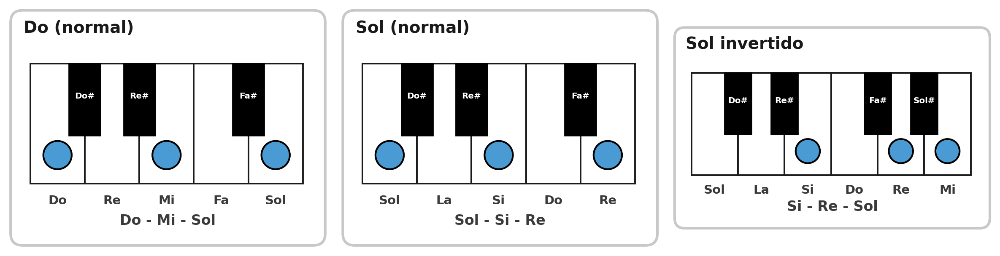{width=16cm}

Mira:

- Sol normal: **Sol – Si – Re** (la mano salta lejos)
- Sol invertido: **Si – Re – Sol** (las notas quedan cerquita)

## Los 4 acordes de la canción, cerquita de Do

Así se tocan los acordes de "La niña de tus ojos" sin mover casi la mano:

| Acorde | Cómo se toca | Notas |
| ------ | ------------ | ----- |
| Do (C) | Normal | Do – Mi – Sol |
| Sol (G) | Invertido | Si – Re – Sol |
| Lam (Am) | Invertido | Do – Mi – La |
| Fa (F) | Invertido | Do – Fa – La |

Fíjate que el **Do** se queda casi en el mismo lugar todo el tiempo. Por eso suena tan bien y es tan fácil.

✋ **Ejercicio:** tocar Do – Sol – Lam – Fa muy lento, sin levantar la mano más de lo necesario. Cuatro veces seguidas.

⭐ **Reto:** hacer el círculo Do – Sol – Lam – Fa cuatro veces sin parar y sin mirar la mano.

---

# Clase 12: Arpegios, acordes que suenan bonito

Un **arpegio** es tocar las notas del acorde **una por una**, como si fueras pasando los dedos por las cuerdas de un arpa. En vez de tocar las tres notas juntas, las tocas en orden.

## El patrón más fácil

Para un acorde de tres notas usamos este camino:

**1 – 3 – 5 – 3**

En Do mayor sería: **Do – Mi – Sol – Mi**, y vuelves a empezar.

## Otro patrón, más suave

**1 – 5 – 3 – 5**

En Do mayor sería: **Do – Sol – Mi – Sol**.

Los dos patrones sirven. Escúchalos y elige el que más te guste para cada canción.

✋ **Ejercicio:** tocar el patrón 1-3-5-3 en Do, después en Sol, después en Lam y después en Fa, sin parar entre acorde y acorde.

> 🎵 Este es el sonido que escuchas en las canciones tranquilas de la iglesia. Con un solo patrón de arpegio ya puedes acompañar muchas alabanzas.

⭐ **Reto:** tocar la introducción de "La niña de tus ojos" con arpegios en vez de acordes.

---

# Clase 13: La mano izquierda y el bajo

Hasta ahora tocamos casi todo con la mano derecha. Ahora entra la **mano izquierda**, que es la que hace que la música suene **llena y profunda**.

## ¿Qué es el bajo?

El **bajo** es la nota que le da el nombre al acorde, pero tocada **grave**, o sea, más a la izquierda en el teclado.

- Si el acorde es Do, el bajo es **Do**.
- Si el acorde es Sol, el bajo es **Sol**.
- Si el acorde es Lam, el bajo es **La**.
- Si el acorde es Fa, el bajo es **Fa**.

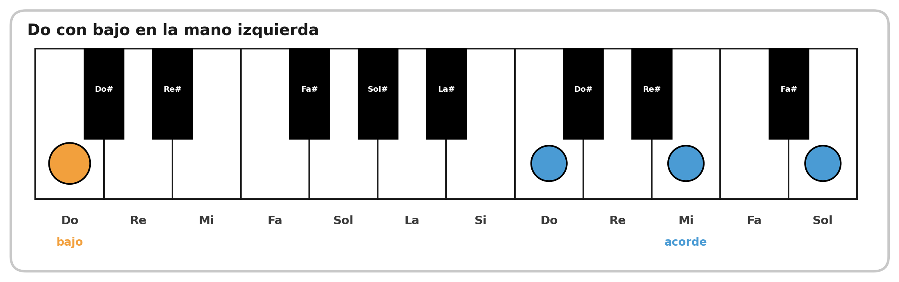{width=16cm}

## El patrón del principiante

Para empezar, lo más fácil es:

- La mano izquierda toca **el bajo en el tiempo 1**.
- La mano derecha toca **el acorde en el tiempo 3**.

Así: **1** (bajo) – 2 – **3** (acorde) – 4.

> 🧠 Es como un corazón: bum... bum... bum... bum. Despacio y parejo.

✋ **Ejercicio:** primero solo la mano izquierda, tocando Do grave en el 1 y en el 3, contando en voz alta. Cuando ya salga, agrega la mano derecha.

> ⚠️ Aviso importante: juntar las dos manos **cuesta**. Es normal. Practica cada mano por separado hasta que salga sola, y después júntalas muy lento. Si te equivocas, vuelve a separarlas. No es retroceder, es la forma correcta de aprender.

⭐ **Reto:** tocar Do – Sol – Lam – Fa con bajo en la izquierda y acorde en la derecha, a velocidad de tortuga.

---

# Clase 14: Bemoles, las notas que faltaban

Ya conocemos los **sostenidos** (#), que suben la nota. Ahora conocemos los **bemoles** (♭), que la bajan.

- **Sostenido (#):** sube un poquito. Do# es la tecla negra a la derecha de Do.
- **Bemol (♭):** baja un poquito. Reb es la tecla negra a la izquierda de Re.

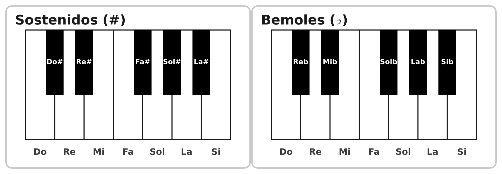{width=16cm}

Mira las dos tarjetas: son **las mismas cinco teclas negras**, solo cambia el nombre.

- Si la nota **sube**, la llamas **sostenido** (Do#, Re#, Fa#, Sol#, La#).
- Si la nota **baja**, la llamas **bemol** (Reb, Mib, Solb, Lab, Sib).

Por eso la misma tecla puede aparecer como **La#** en una canción y como **Sib** en otra. Ninguna de las dos está mal: depende de lo que esté haciendo la música en ese momento. Lo importante es que sepas que es **la misma tecla**.

## La misma tecla con dos nombres

Aquí viene lo curioso: **Do# y Reb son la misma tecla**. El sonido es idéntico, solo cambia el nombre.

| Tecla negra | Nombre con sostenido | Nombre con bemol |
| ----------- | -------------------- | ---------------- |
| Entre Do y Re | Do# | Reb |
| Entre Re y Mi | Re# | Mib |
| Entre Fa y Sol | Fa# | Solb |
| Entre Sol y La | Sol# | Lab |
| Entre La y Si | La# | Sib |

## Cómo se escriben en inglés

| En español | En inglés |
| ---------- | --------- |
| Sib | Bb |
| Mib | Eb |
| Lab | Ab |
| Reb | Db |
| Solb | Gb |

El bemol en inglés se escribe con una **b** minúscula. Por eso Sib se escribe **Bb**.

## ¿Para qué me sirve esto?

Porque muchas alabanzas usan **Sib, Mib, Lab y Reb**, y en internet los vas a encontrar como **Bb, Eb, Ab, Db**. Si no sabes qué son, te quedas trabado en el primer acorde.

✋ **Ejercicio:** tocar cada tecla negra del piano y decir sus dos nombres: "Do sostenido, Reb... Re sostenido, Mib..."

⭐ **Reto:** decir los 12 sonidos del piano en orden, subiendo y después bajando, usando los dos nombres donde corresponda.

---

# Clase 15: Acordes con sostenido (Do#, Re#, Fa#, Sol#, La#)

Hasta ahora casi todos los acordes que aprendimos se tocan en teclas blancas. Pero hay canciones que piden acordes que empiezan en una **tecla negra**. Son cinco:

**Do# – Re# – Fa# – Sol# – La#**

En el teclado están aquí: son las cinco teclas negras de cada octava.

Y aquí viene lo importante: cada uno de estos acordes **también tiene un nombre con bemol**, y se toca exactamente igual. No son dos acordes distintos: es el mismo acorde con dos nombres.

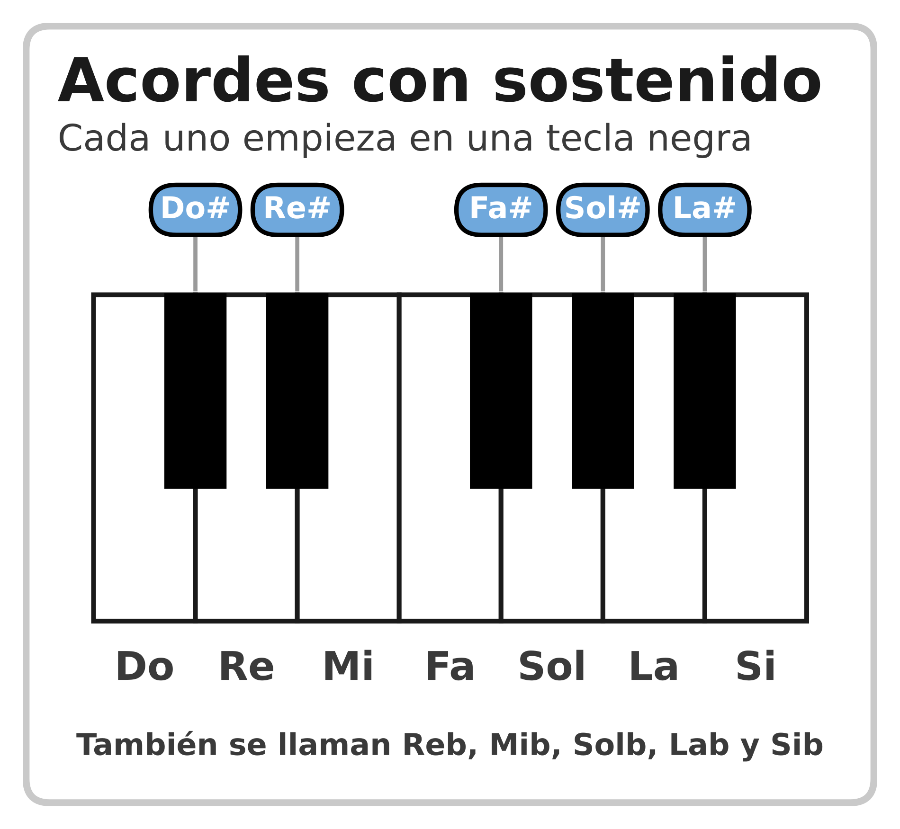{width=10.5cm}

> 🧠 Es lo mismo que viste en la clase 14 con las teclas sueltas: Do# y Reb son la misma tecla. Con los acordes pasa igual.

## Los cinco acordes

| En inglés | Se toca | También se llama |
| --------- | ------- | ---------------- |
| C# | Do# – Fa – Sol# | Reb (Db) |
| D# | Re# – Sol – La# | Mib (Eb) |
| F# | Fa# – La# – Do# | Solb (Gb) |
| G# | Sol# – Do – Re# | Lab (Ab) |
| A# | La# – Re – Fa | Sib (Bb) |

Fíjate en algo: cuando el acorde se llama con sostenido, la nota del medio casi siempre es una **tecla blanca** (Fa, Sol, Do, Re). La única excepción es **Fa#**, que se toca con **tres teclas negras**.

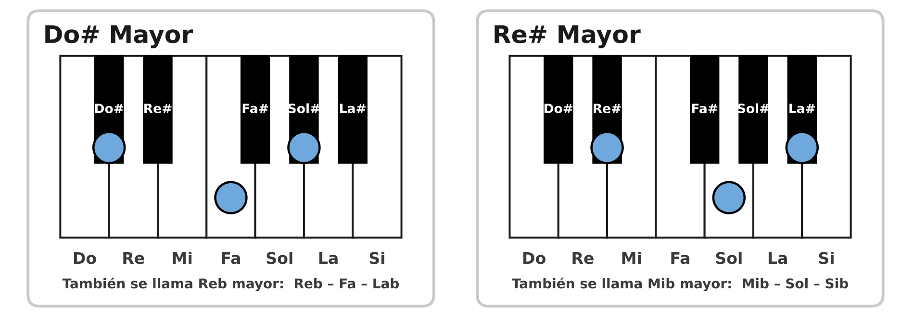{width=16cm}

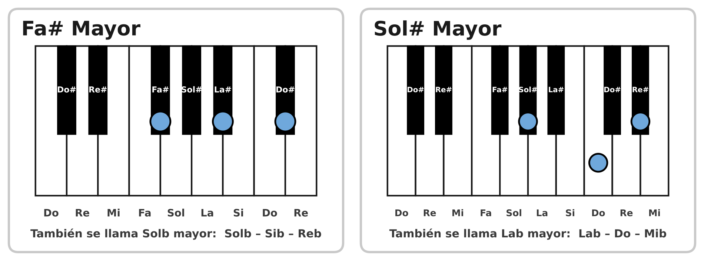{width=16cm}

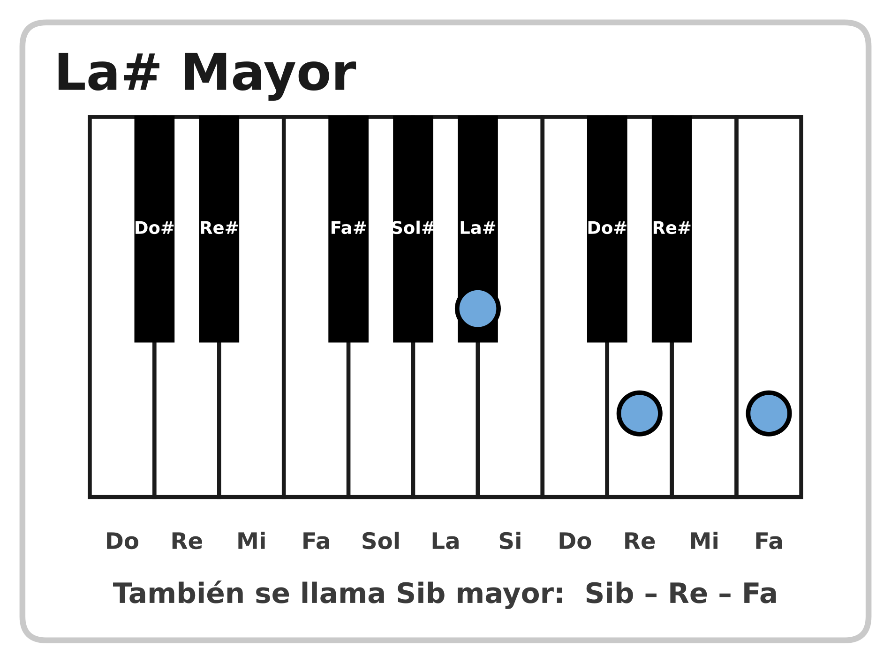{width=10cm}

> 🎵 El **La# mayor** es el mismo acorde de **Sib** que ya tocas en "Hay libertad". En esa canción aparece como Sib porque está escrita con bemoles.

## El truco para encontrar la segunda y la tercera nota

Este truco sirve para **cualquier** acorde mayor, tenga sostenido o no:

1. Toca la nota que le da el nombre al acorde.
2. **Salta 3 teclas** (contando también las negras) y toca la siguiente.
3. **Salta 2 teclas** y toca la siguiente.

Ejemplo con Do#: toco Do#, salto Re, Re# y Mi, y toco **Fa**; después salto Fa# y Sol, y toco **Sol#**. Ya está: Do# – Fa – Sol#.

> 🧠 El truco de la clase 3 ("toca una blanca y salta otra") solo funciona cuando las tres notas son blancas. Este truco de contar teclas funciona **siempre**.

## ¿Cuál de los dos nombres uso?

- Si la canción está escrita con **sostenidos**, usa el nombre con sostenido: Do#, Re#, Fa#...
- Si está escrita con **bemoles**, usa el nombre con bemol: Reb, Mib, Solb...
- En internet vas a encontrar las dos formas. **Se tocan igual.**

✋ **Ejercicio:** tocar los cinco acordes en orden, diciendo el nombre en voz alta: "Do#... Re#... Fa#... Sol#... La#".

✋ **Ejercicio 2:** tocar el mismo acorde dos veces, primero con el nombre sostenido y después con el bemol: "Do#... Reb... Do#... Reb...".

⭐ **Reto:** tocar Do# – Re# – Fa# – Sol# – La# en círculo, cuatro veces seguidas, sin parar y sin mirar las imágenes.

---

# Clase 16: Segunda alabanza, "Hay libertad"

Ahora vamos a usar todo lo aprendido en una alabanza nueva. Esta usa cuatro acordes: **Rem, Sib, Fa y Do** (en inglés: **Dm, Bb, F, C**).

## Los acordes nuevos

| Acorde | Cómo se toca | Notas |
| ------ | ------------ | ----- |
| Rem (Dm) | Menor | Re – Fa – La |
| Sib (Bb) | Mayor | Sib – Re – Fa |
| Fa (F) | Mayor | Fa – La – Do |
| Do (C) | Mayor | Do – Mi – Sol |

> 🧠 Ojo con **Sib**: su primera nota es la **tecla negra** que está a la izquierda del Si. Después Re y Fa, las dos blancas.

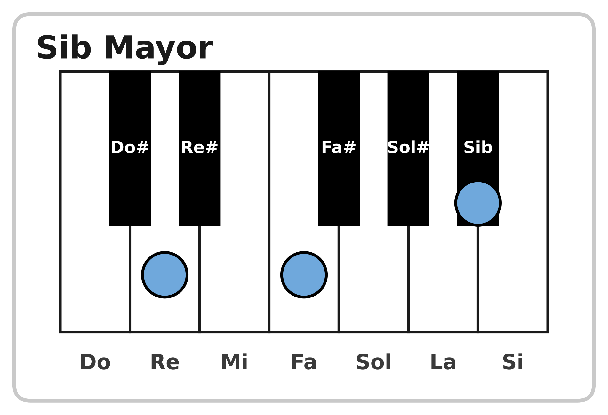{width=11cm}

## La canción

```
Hay Libertad
Art Aguilera

INTRO
Rem  Sib  Fa  Do

VERSO
Rem                        Sib
Hoy puedo danzar con libertad
               Fa                  Do
porque soy tu hijo, porque soy tu hijo
Rem                        Sib
Hoy puedo danzar con libertad
           Fa                Do
porque soy amado, porque soy amado

PRE-CORO x2
            Rem
Podemos sentir tu gozo,
            Sib
podemos sentir tu río
       Fa
hay sanidad en las aguas,
             Do
queremos danzar

CORO x2
          Rem
Hay libertad en la casa de Dios
          Sib
Hay libertad en la casa de Dios
          Fa           Do
hay libertad hay libertad

PUENTE x2
     Rem  Do  Fa        Sib
Hay li--bertad en la casa,
     Rem  Do  Fa        Do
hay li--bertad al danzar
```

## Cómo practicarla

1. **Solo los acordes.** Toca Rem, Sib, Fa, Do en círculo, despacio, hasta que la mano no dude.
2. **Con la grabación.** Pon la canción y toca los acordes encima, sin preocuparte por el ritmo.
3. **Con bajo.** Agrega la mano izquierda en el tiempo 1.
4. **Con arpegio.** Si ya te sale, cambia los acordes por arpegios en las partes tranquilas.

⭐ **Reto:** tocar la canción completa de principio a fin, con la grabación, sin perderte en el coro.

---

# Clase 17: Rutina de práctica y meta del alumno

## La rutina de 15 minutos

No necesitas practicar dos horas. Necesitas practicar **poco, pero todos los días**.

| Tiempo | Qué haces |
| ------ | --------- |
| 3 min | Escala de Do, subiendo y bajando |
| 3 min | Acordes de la canción, en círculo |
| 5 min | La alabanza que estés aprendiendo |
| 2 min | Repaso de la clase anterior |
| 2 min | Tocar algo que te guste, solo por gusto |

Cinco días a la semana es mejor que un solo día de dos horas.

## Cinco consejos que sirven siempre

1. **Lento primero.** Si te equivocas, baja la velocidad a la mitad.
2. **Cuenta en voz alta.** Si puedes contar, puedes tocar.
3. **Una mano a la vez.** Junta las manos solo cuando cada una salga sola.
4. **Grábate con el celular.** Escucharte te enseña más que cualquier explicación.
5. **No pares en el error.** Si te equivocas, sigue. Detenerse en cada error enseña a detenerse.

*Dios les bendiga*
